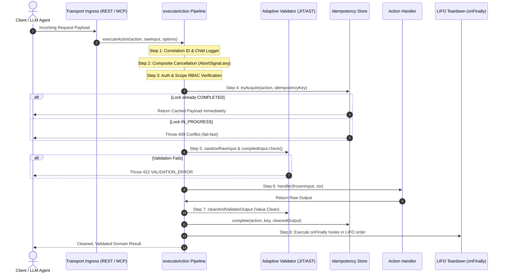

# SHUKOI FRAMEWORK ARCHITECTURE

## 1. Architectural Paradigm: Write-Once Contract-First

Shukoi is an enterprise-grade TypeScript micro-framework operating on the principle of **declarative single-source-of-truth business logic**:

```text
               1 Core Engine (@shukoi/core: defineAction)
                                  │
         ┌────────────────────────┴────────────────────────┐
         ▼                                                 ▼
   Protocol Module A                                 Protocol Module B
     (@shukoi/api)                                     (@shukoi/mcp)
         │                                                 │
   ┌─────┴─────┐                                     ┌─────┴─────┐
   ▼           ▼                                     ▼           ▼
1. REST API  2. OpenAPI 3.1.0                  3. MCP HTTP    4. MCP STDIO
   │           │                                     │           │
   └───────────┼─────────────────────────────────────┴───────────┘
               ▼
     3 Deployment Runtime Targets
       - Cloudflare Workers (@shukoi/cloudflare: V8 Isolates)
       - AWS Lambda (@shukoi/lambda: Node.js 22+ ESM)
       - Self-Host (@shukoi/selfhost: Bun 1.2+ / Node.js 22+ / Docker)
```

---

## 2. Universal Action Execution Sequence (`executeAction`)

Every request across REST, MCP HTTP, and MCP STDIO routes through the identical 8-step pipeline:



---

## 3. Concurrency & Concurrency-Safe State Machines

### 3.1 Single-Flight JWKS Discovery Mutex
Under high concurrency, when a JWKS cache expires, multiple incoming requests could trigger a cache stampede against the auth server. Shukoi utilizes an `inFlightPromise` mutex:
- Request 1 initiates `fetch(jwksUri)` and stores the promise.
- Requests 2..N attach to the existing promise.
- Upon resolution or failure, cache is updated and `inFlightPromise` is reset in a `finally` block.

### 3.2 Atomic Idempotency Locks
Mutating actions (`POST`, `PUT`, `PATCH`, `DELETE`) with `requireIdempotencyKey: true` enforce atomic state transitions:
`UNLOCKED -> IN_PROGRESS -> COMPLETED`.
If an unhandled exception occurs before completion, the lock is released in `finally` so subsequent retries are not deadlocked.

### 3.3 Per-Connection Scoped MCP Server Factory
In `@shukoi/mcp`, the action catalog is compiled once at boot (`compileMcpCatalog`). On every incoming HTTP connection, `createScopedMcpServer` instantiates a lightweight, connection-scoped server. This eliminates the fatal `_transport` overwrite race condition that occurs when a singleton server is shared across concurrent HTTP requests.

---

## 4. Cancellation & Deadline Composition

Every action receives a composite signal constructed via `AbortSignal.any`:
1. **Client Disconnect Signal:** Triggered when the HTTP socket or STDIO pipe closes prematurely.
2. **Action Timeout Signal:** Enforced via `AbortSignal.timeout(effectiveTimeoutMs)`.
3. **Graceful Shutdown Signal:** Intercepts `SIGTERM`/`SIGINT`.
4. **AWS Lambda Remaining Time:** Subtracts `lambdaDeadlineBufferMs` from `context.getRemainingTimeInMillis()` to ensure active transactions roll back before container freeze.

---

## 5. Memory Safety & Stream-Level Defense

1. **Chunked Stream OOM Defense (`readBoundedJsonStream`):**
   Incoming streams are consumed chunk-by-chunk using a `ReadableStreamDefaultReader` with a cumulative byte counter. If `receivedBytes > config.limits.maxBodyBytes`, the reader is cancelled immediately and throws HTTP 413 without buffering the remainder into memory.
2. **Prototype Pollution Defense:**
   All input objects are recursively processed with `Object.create(null)` to eliminate `__proto__`, `constructor`, and `prototype` keys before schema validation.
3. **STDIO Backpressure:**
   Outbound JSON-RPC frames written to `process.stdout` check the boolean return of `write()`. If `false`, subsequent frame writes pause until the `drain` event is emitted.

---

## 6. Error Protocol Translation

| Domain Error Code | HTTP Status | RFC 9457 Problem Details (`@shukoi/api`) | MCP Transport (`@shukoi/mcp`) |
| :--- | :--- | :--- | :--- |
| `BAD_REQUEST` | 400 | `application/problem+json` (`status: 400`) | `{ isError: true, content: ["Error (400): ..."] }` |
| `UNAUTHORIZED` | 401 | `application/problem+json` (`status: 401`) | `{ isError: true, content: ["Error (401): ..."] }` |
| `FORBIDDEN` | 403 | `application/problem+json` (`status: 403`) | `{ isError: true, content: ["Error (403): ..."] }` |
| `NOT_FOUND` | 404 | `application/problem+json` (`status: 404`) | `{ isError: true, content: ["Error (404): ..."] }` |
| `CONFLICT` | 409 | `application/problem+json` (`status: 409`) | `{ isError: true, content: ["Error (409): ..."] }` |
| `PAYLOAD_TOO_LARGE` | 413 | `application/problem+json` (`status: 413`) | `{ isError: true, content: ["Error (413): ..."] }` |
| `VALIDATION_ERROR` | 422 | `application/problem+json` (`status: 422`, `errors: [...]`) | `{ isError: true, content: ["Error (422): ..."] }` |
| `INTERNAL_SERVER_ERROR` | 500 | `application/problem+json` (`status: 500`) | `{ isError: true, content: ["Error (500): ..."] }` |
| `SERVICE_UNAVAILABLE` | 503 | `application/problem+json` (`status: 503`) | `{ isError: true, content: ["Error (503): ..."] }` |
| `GATEWAY_TIMEOUT` | 504 | `application/problem+json` (`status: 504`) | `{ isError: true, content: ["Error (504): ..."] }` |

---

## 7. Runtime Adapters & Edge-to-Cloud Deployment Architecture

Shukoi applications decouple business logic completely from server infrastructure. Actions interact solely with strongly typed inputs, outputs, and the platform-agnostic `ActionExecutionContext`. Runtime adapters bridge incoming gateway events into Web-standard `Request` objects, inject runtime bindings, enforce cancellation deadlines, and serialize responses back to platform proxy formats.

### 7.1 Cloudflare Workers Adapter (`@shukoi/cloudflare`)
- **V8 Isolate Security Boundary:** Contains strictly zero `node:*` imports. Compatible with Cloudflare Workers' strict edge isolates where Node.js built-ins and dynamic `new Function()` JIT compilation are restricted.
- **Typed Platform Context:** Exposes `getCloudflareContext<TEnv>(ctx)` returning `{ env, executionCtx, waitUntil }`. Throws `DomainError('INTERNAL_SERVER_ERROR', ...)` if invoked outside a Cloudflare isolate.
- **Asynchronous Lifecycle Preservation:** Preserves `executionCtx.waitUntil(promise)` to enable post-response asynchronous processing (e.g. telemetry flushing, cache population) without keeping clients waiting.
- **In-Memory Testing Doubles (`@shukoi/cloudflare/testing`):** Provides zero-dependency in-memory doubles `createMockKv(seed?)` and `createMockD1(options?)` backed by native `Map` instances, allowing actions interacting with KV and D1 to be unit tested in Vitest in sub-millisecond execution times without Miniflare or Docker.
- **Tooling Integration:** Turnkey scaffolding generates `wrangler.jsonc` (with `nodejs_compat` flag and observability enabled), `env.d.ts`, and `cf-typegen` commands.

### 7.2 AWS Lambda Adapter (`@shukoi/lambda`)
- **Universal Gateway Event Normalization:** Seamlessly translates events from API Gateway v1 (REST API), API Gateway v2 (HTTP API), Application Load Balancers (ALB), and Lambda Function URLs into Web-standard `Request` objects.
- **Dynamic Deadline Subtraction:** Enforces container freeze protection by monitoring execution time countdown via `context.getRemainingTimeInMillis()`:
  $$\text{effectiveTimeoutMs} = \min(\text{defaultTimeoutMs}, \text{context.getRemainingTimeInMillis()} - \text{config.limits.lambdaDeadlineBufferMs})$$
  If remaining time minus buffer is $\le 0$, immediately returns HTTP 504 Gateway Timeout in RFC 9457 `application/problem+json` without starting database transactions.
- **Container Freeze Safety:** Request signal aborts at `effectiveTimeoutMs`, ensuring in-flight database transactions roll back cleanly before AWS Firecracker microVM execution freeze.
- **Cookie Normalization:** Reads incoming `event.cookies: string[]` in API Gateway v2 into the standard `Cookie` request header. On egress, extracts cookies via `res.headers.getSetCookie()` and sets `result.cookies: string[]` (v2) and `result.multiValueHeaders['set-cookie']` (v1/ALB) while deleting `set-cookie` from single headers to prevent comma-concatenation bugs.
- **Automatic Binary Response Encoding:** Evaluates response Content-Type using `defaultIsContentTypeBinary`. If binary (`image/*`, `application/pdf`, `application/octet-stream`, compressed buffers), converts `arrayBuffer()` to Base64 and sets `isBase64Encoded: true`.
- **BasePath & Stage Prefix Stripping:** Automatically removes `options.basePath` and API Gateway v1 stage prefixes (`event.requestContext.stage`) from URL pathnames, preventing 404 routing errors.
- **In-Memory Testing Doubles (`@shukoi/lambda/testing`):** Provides `createMockLambdaContext`, `createMockApiGatewayV2Event`, and `createMockApiGatewayV1Event` for instantaneous unit testing without SAM CLI or Docker.

### 7.3 Self-Host Server Adapter (`@shukoi/selfhost`)
- **Dual Runtime Server Daemon:** Operates on long-running servers using Node.js 22+ LTS or Bun 1.2+.
- **Stream-Level Bounded Ingress (OOM Defense):** Enforces `config.limits.maxBodyBytes` by consuming incoming request body chunks through an accumulating byte counter. Rejects oversized requests immediately with RFC 9457 HTTP 413 Problem Details (`PAYLOAD_TOO_LARGE`) and destroys the stream, bounding memory overhead to a single chunk ($O(1)$ heap overhead) and eliminating OOM DoS attack vectors.
- **Typed Platform Context:** Exposes `getSelfHostContext(ctx)` returning `{ remoteAddress, remotePort, incoming, outgoing, serverState }`.
- **Full Egress Cookie Preservation:** Extracts cookies via `(webResponse.headers as any).getSetCookie()` and passes an array to `res.setHeader('set-cookie', cookies)`, preserving multiple distinct cookies without browser-breaking comma merging.
- **Socket Backpressure Handling:** Observes `res.write(value)` return values during response streaming; if false, halts stream reading until the TCP socket emits the `'drain'` event, preventing socket buffer bloat on slow client connections.
- **Dynamic Kubernetes Container Probes:**
  - Liveness (`options.livenessPath`, default `/healthz/live`): Returns HTTP 200 while process daemon is active.
  - Readiness (`options.readinessPath`, default `/healthz/ready`): Returns HTTP 200 when `HEALTHY` and optional `isReady` hook passes. Evaluates `options.isReady?: () => Promise<boolean> | boolean` (e.g. database pool ping); returns HTTP 503 (`unhealthy`) when unready.
- **Deterministic Graceful Drain State Machine:** Traps POSIX `SIGTERM` and `SIGINT` signals. Transitions state `STARTING` $\rightarrow$ `HEALTHY` $\rightarrow$ `DRAINING` $\rightarrow$ `TERMINATED`. Rejects new ingress with 503, drains active in-flight requests up to `shutdownGracePeriodMs`, destroys keep-alive sockets, runs `onShutdown()` teardown hooks, and exits code 0.
- **In-Memory Testing Doubles (`@shukoi/selfhost/testing`):** Exports `createMockSelfHostContext` for testing client IP, port, and server state in Vitest without binding live OS network sockets.
- **Container Hardening:** Turnkey scaffolding generates a multi-stage `Dockerfile` (`node:22-alpine`, non-root user `USER node`, frozen lockfile) and `.dockerignore`.
