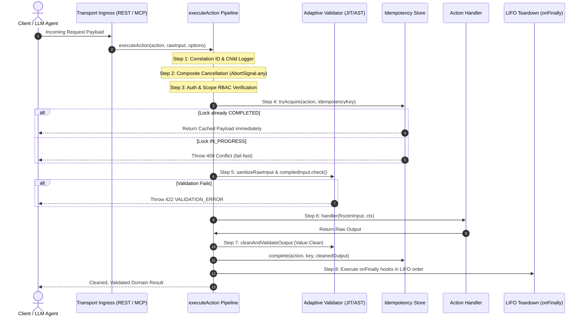

# SHUKOI FRAMEWORK ARCHITECTURE

## 1. Architectural Paradigm: Write-Once Contract-First

Shukoi is an enterprise-grade TypeScript micro-framework operating on the principle of **declarative single-source-of-truth business logic**:

```text
               1 Core Engine (@shukoi/core: defineAction)
                                  │
         ┌────────────────────────┴────────────────────────┐
         ▼                                                 ▼
   Protocol Module A                                 Protocol Module B
     (@shukoi/api)                                     (@shukoi/mcp)
         │                                                 │
   ┌─────┴─────┐                                     ┌─────┴─────┐
   ▼           ▼                                     ▼           ▼
1. REST API  2. OpenAPI 3.1.0                  3. MCP HTTP    4. MCP STDIO
   │           │                                     │           │
   └───────────┼─────────────────────────────────────┴───────────┘
               ▼
     3 Deployment Runtime Targets
       - Cloudflare Workers (@shukoi/cloudflare: V8 Isolates)
       - AWS Lambda (@shukoi/lambda: Node.js 22+ ESM)
       - Self-Host (@shukoi/selfhost: Bun 1.2+ / Node.js 22+ / Docker)
```

---

## 2. Universal Action Execution Sequence (`executeAction`)

Every request across REST, MCP HTTP, and MCP STDIO routes through the identical 8-step pipeline:



---

## 3. Concurrency & Concurrency-Safe State Machines

### 3.1 Single-Flight JWKS Discovery Mutex
Under high concurrency, when a JWKS cache expires, multiple incoming requests could trigger a cache stampede against the auth server. Shukoi utilizes an `inFlightPromise` mutex:
- Request 1 initiates `fetch(jwksUri)` and stores the promise.
- Requests 2..N attach to the existing promise.
- Upon resolution or failure, cache is updated and `inFlightPromise` is reset in a `finally` block.

### 3.2 Atomic Idempotency Locks
Mutating actions (`POST`, `PUT`, `PATCH`, `DELETE`) with `requireIdempotencyKey: true` enforce atomic state transitions:
`UNLOCKED -> IN_PROGRESS -> COMPLETED`.
If an unhandled exception occurs before completion, the lock is released in `finally` so subsequent retries are not deadlocked.

### 3.3 Per-Connection Scoped MCP Server Factory
In `@shukoi/mcp`, the action catalog is compiled once at boot (`compileMcpCatalog`). On every incoming HTTP connection, `createScopedMcpServer` instantiates a lightweight, connection-scoped server. This eliminates the fatal `_transport` overwrite race condition that occurs when a singleton server is shared across concurrent HTTP requests.

---

## 4. Cancellation & Deadline Composition

Every action receives a composite signal constructed via `AbortSignal.any`:
1. **Client Disconnect Signal:** Triggered when the HTTP socket or STDIO pipe closes prematurely.
2. **Action Timeout Signal:** Enforced via `AbortSignal.timeout(effectiveTimeoutMs)`.
3. **Graceful Shutdown Signal:** Intercepts `SIGTERM`/`SIGINT`.
4. **AWS Lambda Remaining Time:** Subtracts `lambdaDeadlineBufferMs` from `context.getRemainingTimeInMillis()` to ensure active transactions roll back before container freeze.

---

## 5. Memory Safety & Stream-Level Defense

1. **Chunked Stream OOM Defense (`readBoundedJsonStream`):**
   Incoming streams are consumed chunk-by-chunk using a `ReadableStreamDefaultReader` with a cumulative byte counter. If `receivedBytes > config.limits.maxBodyBytes`, the reader is cancelled immediately and throws HTTP 413 without buffering the remainder into memory.
2. **Prototype Pollution Defense:**
   All input objects are recursively processed with `Object.create(null)` to eliminate `__proto__`, `constructor`, and `prototype` keys before schema validation.
3. **STDIO Backpressure:**
   Outbound JSON-RPC frames written to `process.stdout` check the boolean return of `write()`. If `false`, subsequent frame writes pause until the `drain` event is emitted.

---

## 6. Error Protocol Translation

| Domain Error Code | HTTP Status | RFC 9457 Problem Details (`@shukoi/api`) | MCP Transport (`@shukoi/mcp`) |
| :--- | :--- | :--- | :--- |
| `BAD_REQUEST` | 400 | `application/problem+json` (`status: 400`) | `{ isError: true, content: ["Error (400): ..."] }` |
| `UNAUTHORIZED` | 401 | `application/problem+json` (`status: 401`) | `{ isError: true, content: ["Error (401): ..."] }` |
| `FORBIDDEN` | 403 | `application/problem+json` (`status: 403`) | `{ isError: true, content: ["Error (403): ..."] }` |
| `NOT_FOUND` | 404 | `application/problem+json` (`status: 404`) | `{ isError: true, content: ["Error (404): ..."] }` |
| `CONFLICT` | 409 | `application/problem+json` (`status: 409`) | `{ isError: true, content: ["Error (409): ..."] }` |
| `PAYLOAD_TOO_LARGE` | 413 | `application/problem+json` (`status: 413`) | `{ isError: true, content: ["Error (413): ..."] }` |
| `VALIDATION_ERROR` | 422 | `application/problem+json` (`status: 422`, `errors: [...]`) | `{ isError: true, content: ["Error (422): ..."] }` |
| `INTERNAL_SERVER_ERROR` | 500 | `application/problem+json` (`status: 500`) | `{ isError: true, content: ["Error (500): ..."] }` |
| `SERVICE_UNAVAILABLE` | 503 | `application/problem+json` (`status: 503`) | `{ isError: true, content: ["Error (503): ..."] }` |
| `GATEWAY_TIMEOUT` | 504 | `application/problem+json` (`status: 504`) | `{ isError: true, content: ["Error (504): ..."] }` |
